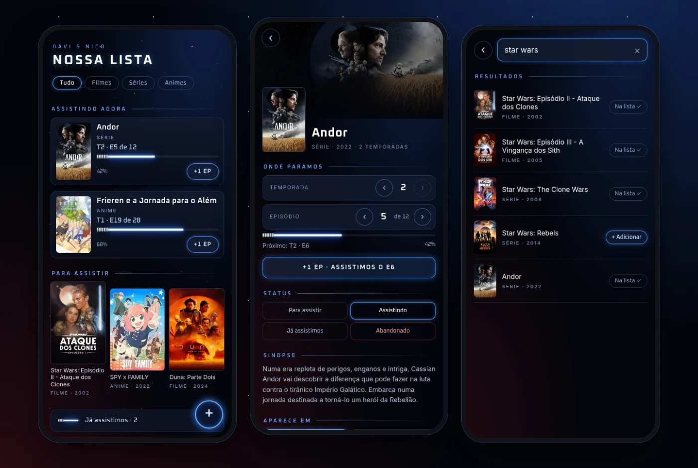
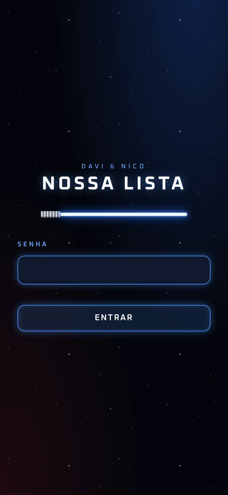
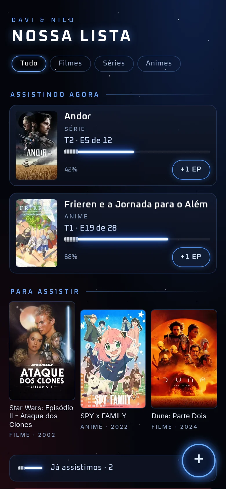
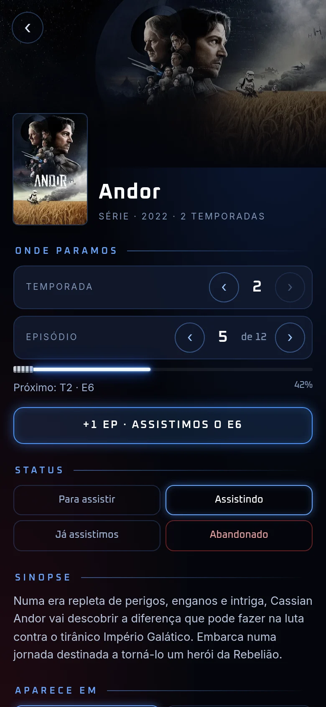
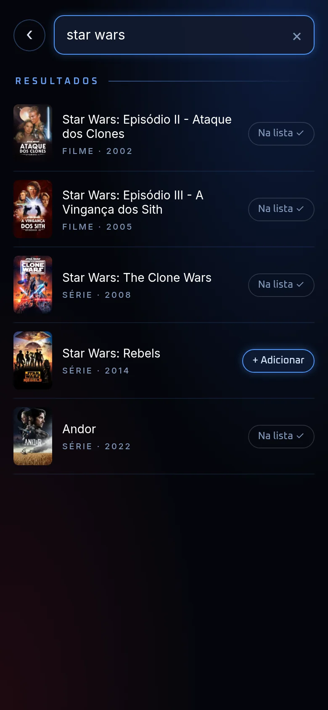
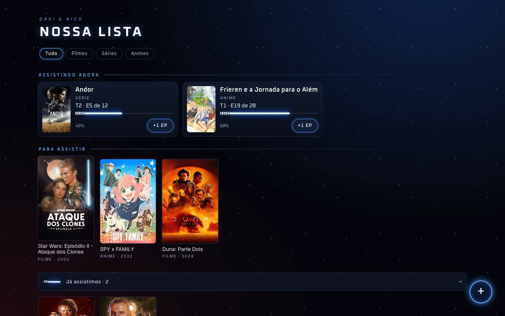
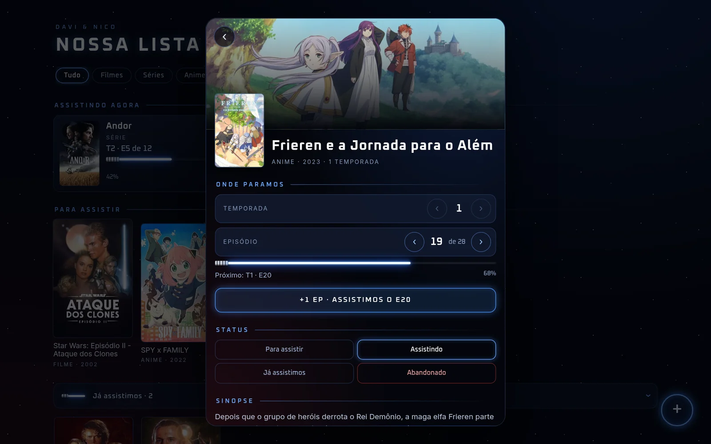
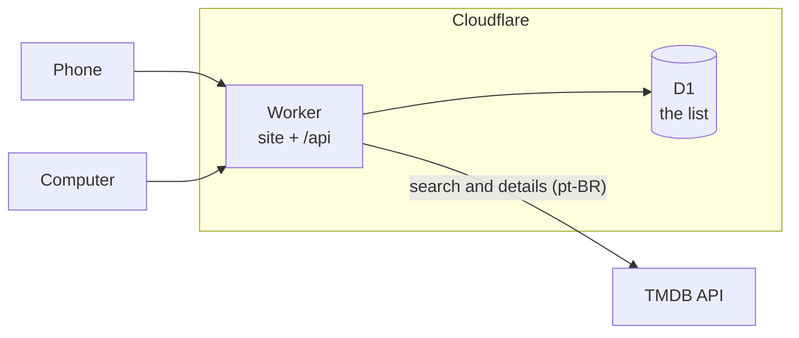

# Nossa Lista

A private watchlist for two people. It holds the movies, series and anime me and my partner watch together, with one shared progress per title, on the phone and on the computer.



<sub>Home · a series' page · adding from TMDB. The interface is in Brazilian Portuguese.</sub>

## What it does

When two people watch shows together, they both need to know what's next and which episode they stopped at, and they need to see the same thing on any device. Nossa Lista keeps that in one place:

- **One list, every device.** Changes save right away and show up on the other person's phone or computer.
- **Progress for each title.** Series and anime show where you stopped (season and episode), with a lightsaber-style progress bar. **+1 EP** marks the next episode as watched. After a season finale it moves to the next season, and after the last episode it moves the show to *Já assistimos* (watched), with an undo.
- **Search powered by TMDB.** Posters, Portuguese titles, synopses and the number of episodes in each season are filled in automatically. Japanese animation is filed under *Animes*, and you can move a title if the guess is wrong.
- **Organized by status:** *Assistindo agora* (watching), *Para assistir* (to watch), *Já assistimos* (watched) and *Abandonados* (dropped). Filters show only movies, series or anime.
- **Private.** One shared password, and each device stays signed in.
- **Installs like an app.** Add it to the phone's home screen and it opens full screen with its own icon.
- **A Star Wars–inspired look.** A dark starfield, Anakin-blue lightsabers as progress bars, and a red blade for what you gave up on.

## Screenshots

<table>
  <tr>
    <td align="center"><br><sub>Login</sub></td>
    <td align="center"><br><sub>Home</sub></td>
    <td align="center"><br><sub>A series' page</sub></td>
    <td align="center"><br><sub>Adding from TMDB</sub></td>
  </tr>
</table>

On the computer, the same page spreads out, and a title's page opens as a panel:





## Built with

| Part | Technology |
| --- | --- |
| Hosting and API | [Cloudflare Workers](https://developers.cloudflare.com/workers/), serving the static site and a small JSON API |
| Database | [Cloudflare D1](https://developers.cloudflare.com/d1/) (SQLite) |
| Movie and series data | [TMDB API](https://developer.themoviedb.org/), in pt-BR |
| Front end | Plain HTML, CSS and JavaScript modules: no framework, no build step |
| Sign-in | Session cookies signed with HMAC through the Web Crypto API |
| Installable app | Web app manifest and a service worker |
| Tests | Node's built-in test runner, with `node:sqlite` standing in for D1 |

Everything runs on Cloudflare's free plan, which doesn't sleep when nobody is using it.

## How it works



A few decisions worth knowing about:

- **Two devices, one list, no real-time server.** Every title has a version number. Edits show on screen immediately and are sent one at a time per title, each based on the version the server last confirmed, so two quick taps on **+1 EP** never conflict with each other. If the other device changed the same title first, the server refuses the outdated edit, and the screen shows the newest version instead of overwriting it. Devices reload the list when the site is opened or brought back to the front, and every 30 seconds while it's visible.
- **Sessions without a sessions table.** The cookie holds an expiry time and an HMAC signature. The signing key mixes a server secret with the password, so changing the password signs every device out. A session lasts a year and renews itself while in use. After ten wrong passwords, that IP address is blocked for up to 15 minutes.
- **The TMDB token stays on the server.** The worker calls TMDB and sends the browser only what the page needs.
- **The episode rules live in one small, tested module**, [`public/js/progress.js`](public/js/progress.js). It covers moving from a season finale to the next season, season numbers missing from TMDB's data, and seasons whose episode count isn't known yet. Before **+1 EP** marks a show as finished, the app also asks TMDB whether new episodes have come out.

## Project structure

```
src/
  worker.js        API routes
  session.js       password check and signed session cookies
  throttle.js      login throttling per IP address
  tmdb.js          TMDB search and details
  titles.js        reading and writing the list
migrations/        D1 schema
public/            the site
  index.html
  css/app.css
  js/
    app.js         screens and interactions
    store.js       the list on this device: instant edits, queued saves, conflict handling
    progress.js    episode and season rules
    list.js        grouping for the home page
    api.js, ui.js
  manifest.webmanifest, sw.js, icons/
test/              API, sync and progress tests
docs/screenshots/  images for this README
```

## Run it locally

Requires Node.js 22.13 or newer.

```sh
npm install
cp .dev.vars.example .dev.vars   # set a password and a session secret; add a TMDB token to enable search
npm run dev                      # http://localhost:8787
```

## Tests

```sh
npm test
```

The API tests run the real worker against an in-memory SQLite database with the real migrations, and a fake TMDB that answers like the real one, including its 401 and 404 errors. The sync tests run the browser's sync code against that same worker, so they cover quick double taps, edits from the other device and failed saves.

## Deploy your own copy

1. Get a free TMDB **API Read Access Token**: create an account at [themoviedb.org](https://www.themoviedb.org/signup), then go to Settings → API.
2. Log in to Cloudflare: `npx wrangler login`
3. Create the database with `npx wrangler d1 create lista-assistir`, and copy the `database_id` it prints into `wrangler.jsonc`.
4. Publish: `npm run deploy`. This applies the migrations, then deploys.
5. Add the secrets. The word after `put` is the secret's name, so type it exactly as shown. Paste the value only when asked for it.
   ```sh
   npx wrangler secret put APP_PASSWORD     # the password you'll share
   npx wrangler secret put TMDB_TOKEN       # the TMDB token
   npx wrangler secret put SESSION_SECRET   # any long random string
   ```

To use other names, change "Davi & Nico" in `public/index.html` and `public/manifest.webmanifest`.

## Credits

- Movie, series and anime data and images come from [TMDB](https://www.themoviedb.org/). This product uses the TMDB API but is not endorsed or certified by TMDB.
- Star Wars is a trademark of Lucasfilm. This is a personal, non-commercial fan project and is not affiliated with Lucasfilm or Disney. The look is only inspired by the films, and no official artwork is used.
- Fonts: [Oxanium](https://fonts.google.com/specimen/Oxanium) and [Inter](https://fonts.google.com/specimen/Inter).
